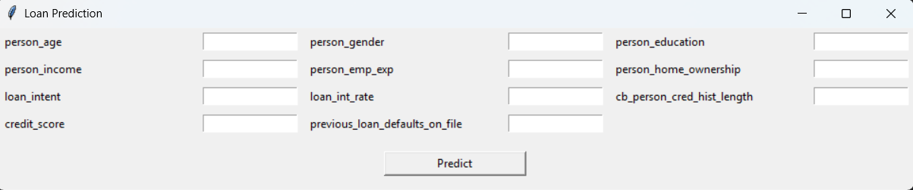

# Loan Prediction

This project uses Machine Learning to predict whether a person will be granted a loan or not.

## Features

The model uses the following information:

- Age
- Gender
- Education
- Income
- Employment Experience
- Home Ownership
- Loan Amount
- Loan Intent
- Loan Interest Rate
- Credit History Length
- Previous Loan Defaults

## Machine Learning Models

Two Machine Learning models are used in this project.

### Classification

The classification model predicts whether the person will be granted a loan or not.

The result can be:

- Loan Granted
- Loan Not Granted

### Regression

If the loan is granted, the regression model predicts the loan amount.

## Acc

Accuracy: 0.9905191269606005

## precision

presicion = 1.0

## tkinter page


## Dataset

The main features used in the project are:

```text
person_age
person_gender
person_education
person_income
person_emp_exp
person_home_ownership
loan_amnt
loan_intent
loan_int_rate
cb_person_cred_hist_length
previous_loan_defaults_on_file